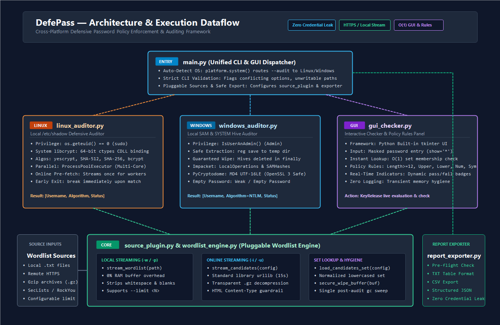

# DefePass — Defensive Password Policy Enforcement & Auditing Tool

# This tool was built with the help of AI.



**DefePass** is a high-performance, modular, and cross-platform defensive password auditing and policy enforcement tool engineered in Python (compatible with Python 3.11–3.13+ on Windows and Linux). It empowers system administrators and security auditors to audit local system credentials against weak password dictionaries safely and instantaneously without risking credential leakage.

---

## 🔒 Security & Performance Guarantees

1. **Zero Credential Leakage**:
   - Plaintext passwords, candidate words, and hash pre-images are **NEVER** printed, logged via `logging`, or written to disk/history/exported reports.
   - Audit findings strictly surface three fields: `Username`, `Algorithm`, and `Status` (`Weak / Matched`, `Weak / Empty Password`, or `Strong / Not Matched`).
2. **Memory Hygiene & Buffer Sanitization**:
   - Sensitive mutable buffers (e.g., candidate byte arrays) are wiped immediately after hash computations using zeroing routines (`secure_wipe_buffer`).
3. **Pluggable Wordlist Source Engine (Local & Online Streaming)**:
   - **Local Streaming (`-w` / `-p`)**: Uses Python generators to stream local dictionaries line-by-line with **0% RAM buffering overhead**, ideal for multi-gigabyte lists (e.g., RockYou).
   - **Online HTTPS Streaming (`-i` / `-u`)**: Incrementally streams wordlists directly over secure HTTPS using Python standard library (`urllib.request`), transparently decompressing `.gz` streams on the fly, with guardrails rejecting HTML web pages and enforcing timeout limits.
   - **Candidate Limit (`--limit <N>`)**: Safely limits evaluated words to a user-defined threshold across both local and online sources.
   - **In-Memory Hash Set Mode**: Loads normalized words into an in-memory hash set for instant **$O(1)$ constant-time lookup** in interactive GUI checks.
4. **Multi-Core Parallel Auditing (`ProcessPoolExecutor`)**:
   - Linux shadow auditing utilizes `concurrent.futures.ProcessPoolExecutor` with `max_workers=min(len(entries), os.cpu_count() or 1)` to audit multiple accounts concurrently across all available CPU cores, loading `libcrypt` dynamically in each worker process without Python GIL limitations. In online mode, the wordlist is fetched once in the main process to prevent duplicate network traffic.
5. **Early Exit & Reverse Mapping Optimization**:
   - In Linux shadow auditing, computation terminates immediately (`break`) upon the first matching candidate for each account, saving CPU cycles on computationally intensive modern hashes like `yescrypt`.
   - In Windows NTLM auditing, accounts are indexed in an $O(1)$ reverse dictionary map (`hash_to_users`), enabling **single-pass dictionary auditing** for all system users simultaneously.
   - Accounts configured with an empty password (NTLM hash `31d6cfe0d16ae931b73c59d7e0c089c0`) are flagged immediately as `Weak / Empty Password`.
6. **Safe Report Exporter & Pre-flight Validation**:
   - Audit reports can be exported to `txt`, `csv`, or `json` formats via `-o` / `--output` and `--format`.
   - Pre-flight write tests validate target filepaths before any audit work starts, failing fast if the parent directory does not exist or lacks write permissions.
7. **Seamless Automatic `.venv` Bootstrapper**:
   - Running `python main.py --audit` on Windows or `sudo python3 main.py --audit` on Linux automatically detects and re-executes inside `.venv` without requiring manual virtual environment activation or risking missing dependencies.

---

## 📂 Project Architecture

```text
DefePass/
├── .venv/                      # Local isolated Python virtual environment
├── architecture_diagram.svg    # High-resolution vector architecture diagram
├── architecture_diagram.png    # High-resolution raster diagram (for PDF/reports)
├── gui_checker.py              # Interactive Tkinter password checker UI & policy rules
├── linux_auditor.py            # Linux /etc/shadow defensive auditor (libcrypt & multiprocessing)
├── main.py                     # Unified CLI & GUI dispatcher with auto OS detection & validation
├── report_exporter.py          # Safe report exporter (TXT, CSV, JSON) with pre-flight validation
├── requirements.txt            # PyCryptodome, Impacket, and Certifi dependencies
├── source_plugin.py            # Pluggable wordlist source engine (Local & HTTPS streaming)
├── windows_auditor.py          # Windows SAM/SYSTEM defensive auditor (Impacket/NTLM)
├── wordlist.txt                # Sample weak passwords dictionary
├── wordlist_engine.py          # Memory-efficient generator & O(1) set loader facade
└── tests/                      # Comprehensive unit test suite (63 tests)
    ├── test_gui_checker.py
    ├── test_linux_auditor.py
    ├── test_main_cli.py
    ├── test_report_exporter.py
    ├── test_source_plugin.py
    └── test_wordlist_engine.py
```

---

## 🛠️ CLI Options Reference

```text
usage: DefePass [-h] (--audit | --audit-linux | --audit-windows | --gui)
                [-w WORDLIST] [-i] [-u URL] [--limit LIMIT] [-o OUTPUT]
                [--format {txt,csv,json}] [-v] [--shadow SHADOW] [--sam SAM]
                [--system SYSTEM] [--ntlm NTLM]
```

| Argument Group | Option | Description |
|---|---|---|
| **Audit Modes** | `--audit` | Auto-detect host OS and run local system audit (Linux shadow or Windows SAM). |
| | `--audit-linux` | Run defensive audit against a Linux `/etc/shadow` file. |
| | `--audit-windows` | Run defensive audit against Windows SAM/SYSTEM hives or NTLM dump. |
| | `--gui` | Launch interactive Tkinter password safety & policy checker GUI. |
| **Wordlist Sources** | `-w`, `-p`, `--wordlist` | Path to local password dictionary file (default: `wordlist.txt`). |
| | `-i`, `--online` | Enable streaming wordlist from a remote HTTPS URL. |
| | `-u`, `--url <URL>` | Target HTTPS URL for online wordlist streaming (`https://` required). |
| | `--limit <N>` | Maximum number of wordlist entries to stream and evaluate ($N > 0$). |
| **Reporting** | `-o`, `--output <FILE>`| Export audit findings to a report file (fails fast if unwritable). |
| | `--format {txt,csv,json}` | Format for exported report file (default: `txt`). |
| | `-v`, `--verbose` | Enable verbose logging output (without credential leakage). |
| **OS-Specific** | `--shadow <FILE>` | Linux `/etc/shadow` file path (used with `--audit-linux`). |
| | `--sam <FILE>` | Windows SAM hive path (used with `--audit-windows`). |
| | `--system <FILE>` | Windows SYSTEM hive path (used with `--audit-windows`). |
| | `--ntlm <FILE>` | Exported NTLM hashes file path (used with `--audit-windows`). |

---

## 🚀 Setup & Execution Guide

### 🪟 Windows Setup & Execution

#### 1. Setup Virtual Environment

Open PowerShell in the project directory:

```powershell
# Create virtual environment if not already present
python -m venv .venv

# Activate virtual environment
.\.venv\Scripts\Activate.ps1

# Install required dependencies
pip install -r requirements.txt
```

#### 2. Run Automated Local System Audit (Requires Administrator)

Open PowerShell or Windows Terminal as **Administrator** ("Run as Administrator"):

```powershell
# Auto-detects Windows and audits local SAM/SYSTEM registry hives
.\.venv\Scripts\python.exe main.py --audit

# Audit using an online HTTPS wordlist (e.g. GitHub raw file) with limit:
.\.venv\Scripts\python.exe main.py --audit -i -u https://raw.githubusercontent.com/danielmiessler/SecLists/master/Passwords/Common-Credentials/10-million-password-list-top-1000.txt --limit 1000

# Audit and export report to JSON:
.\.venv\Scripts\python.exe main.py --audit -o audit_report.json --format json
```

#### 3. Run Offline Hash Dump Audit (No Administrator Required)

```powershell
.\.venv\Scripts\python.exe main.py --audit-windows --ntlm tests\sample_hashes.txt -w wordlist.txt -o report.csv --format csv
```

#### 4. Launch Interactive Tkinter GUI Checker

```powershell
# With local wordlist
.\.venv\Scripts\python.exe main.py --gui -p wordlist.txt

# With online HTTPS wordlist
.\.venv\Scripts\python.exe main.py --gui -i -u https://raw.githubusercontent.com/danielmiessler/SecLists/master/Passwords/Common-Credentials/10-million-password-list-top-1000.txt --limit 1000
```

---

### 🐧 Linux Setup & Execution

#### 1. Setup Virtual Environment

Open a terminal in the project directory:

```bash
# Create and activate virtual environment
python3 -m venv .venv
source .venv/bin/activate

# Install dependencies
pip install -r requirements.txt
```

#### 2. Create Test Accounts for Verification (Demo Scenario)

To capture side-by-side screenshots demonstrating weak vs. strong detection:

```bash
# 1. Create a weak test account (password in wordlist.txt: 'password')
sudo useradd -m test_weak
echo "test_weak:password" | sudo chpasswd

# 2. Create a strong test account (complex password NOT in wordlist)
sudo useradd -m test_strong
echo "test_strong:K9#mQ2!xL8@wR5$v" | sudo chpasswd
```

#### 3. Run Automated Local System Audit (Requires Root / sudo)

```bash
# Run using the virtual environment with sudo
sudo ./.venv/bin/python main.py --audit

# Audit with an online HTTPS wordlist and export report to CSV:
sudo ./.venv/bin/python main.py --audit -i -u https://raw.githubusercontent.com/danielmiessler/SecLists/master/Passwords/Common-Credentials/10-million-password-list-top-1000.txt --limit 5000 -o /var/log/defepass_audit.csv --format csv
```

#### 4. Clean Up Test Accounts (Post-Verification)

```bash
sudo userdel -r test_weak
sudo userdel -r test_strong
```

---

## 📊 Exported Report Samples

All exported reports maintain strict compliance with zero credential leakage principles.

### TXT Format
```text
=================================================================
Username             | Algorithm       | Status                   
=================================================================
Administrator        | NTLM            | Weak / Empty Password    
test_weak            | yescrypt        | Weak / Matched           
test_strong          | yescrypt        | Strong / Not Matched     
=================================================================
Total Accounts Audited: 3
```

### CSV Format
```csv
Username,Algorithm,Status
Administrator,NTLM,Weak / Empty Password
test_weak,yescrypt,Weak / Matched
test_strong,yescrypt,Strong / Not Matched
```

### JSON Format
```json
[
  {
    "Username": "Administrator",
    "Algorithm": "NTLM",
    "Status": "Weak / Empty Password"
  },
  {
    "Username": "test_weak",
    "Algorithm": "yescrypt",
    "Status": "Weak / Matched"
  },
  {
    "Username": "test_strong",
    "Algorithm": "yescrypt",
    "Status": "Strong / Not Matched"
  }
]
```

---

## 🖥️ Interactive GUI Checker & Enterprise Policy Rules

The Tkinter GUI (`main.py --gui`) provides a real-time defensive evaluation workstation:

- **Dictionary Match Checking**: Evaluates entered candidate passwords instantaneously ($O(1)$ lookup) against local or online wordlists.
- **Enterprise Complexity Rules Panel**:
  - `✓ / ✗ Length >= 12 characters`
  - `✓ / ✗ At least one uppercase letter (A-Z)`
  - `✓ / ✗ At least one lowercase letter (a-z)`
  - `✓ / ✗ At least one numerical digit (0-9)`
  - `✓ / ✗ At least one special symbol (!@#$...)`
- **Zero-Storage Guarantee**: Passwords evaluated inside the GUI are transiently processed in memory and never persisted to history, log files, or disk.

---

## 🧪 Running Unit Tests

Run the full project test suite inside `.venv`:

```powershell
# Windows
.\.venv\Scripts\python.exe -m unittest discover tests

# Linux
./.venv/bin/python -m unittest discover tests
```

All 63 unit tests cover:
- Automatic `.venv` bootstrapping and re-execution across platforms.
- Pluggable wordlist source engine (local file, HTTPS streaming, gzip decompression, HTML rejection, word limits).
- Safe report exporter (TXT, CSV, JSON generation, zero credential leakage validation, pre-flight file check).
- CLI strict argument validation and exit code 2 enforcement.
- `libcrypt` system bindings, hash algorithm detection, parallel multiprocessing, and early exit.
- NTLM hash calculation (OpenSSL 3 compliant), empty password detection, and hive cleanup in `finally`.
- GUI evaluation logic, input masking, policy rule indicators, and event bindings.
